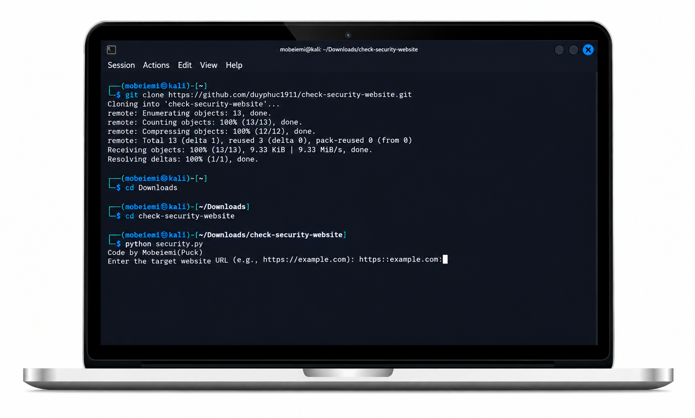
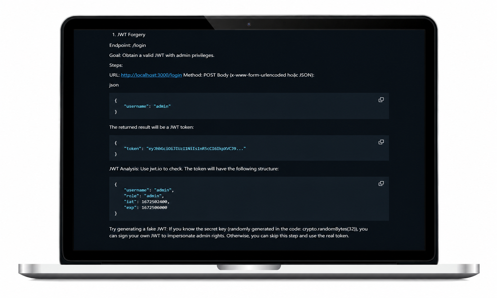
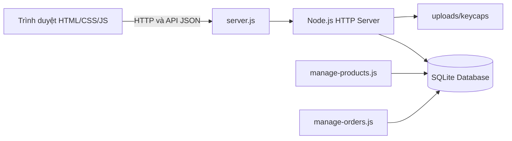
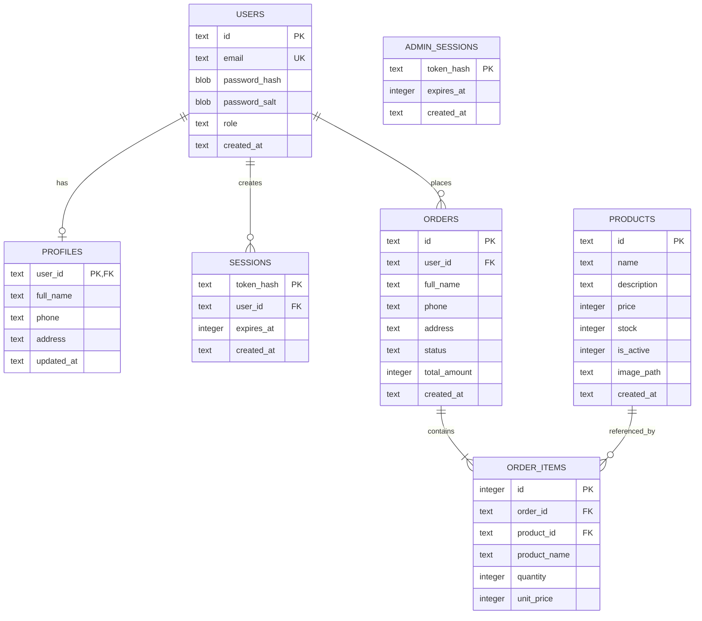
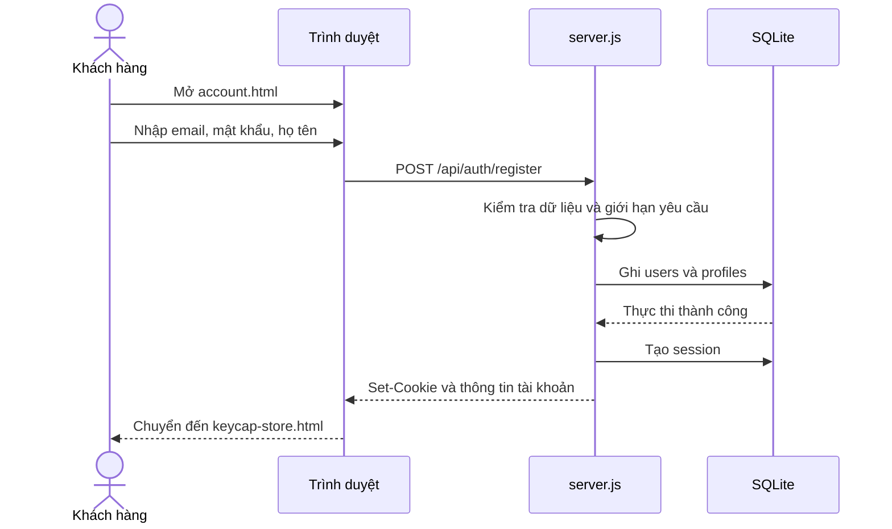
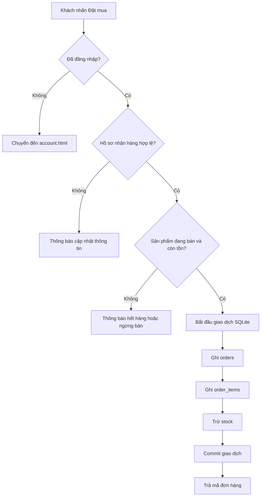

# BÁO CÁO ĐỒ ÁN - WEBSITE PROFILE PORTFOLIO

## TRANG BÌA

**BỘ GIÁO DỤC VÀ ĐÀO TẠO**  
**TRƯỜNG ĐẠI HỌC NGOẠI NGỮ - TIN HỌC THÀNH PHỐ HỒ CHÍ MINH**  
**KHOA CÔNG NGHỆ THÔNG TIN**

<div align="center">


</div>

**ĐỒ ÁN MÔN HỌC:**  
**LẬP TRÌNH WEB**

**ĐỀ TÀI: XÂY DỰNG WEBSITE PROFILE PORTFOLIO**

**GIÁO VIÊN HƯỚNG DẪN:** ĐẶNG THỊ KIM GIAO

**NHÓM 8 THỰC HIỆN:**

| MSSV | Họ và tên |
| --- | --- |
| 25DH110036 | NGUYỄN TRÍ DŨNG |
| 25DH110038 | MAI VĂN BÌNH |
| 25DH110138 | TRẦN TÚ DUY PHÚC |
| 25DH110215 | ĐẶNG PHƯƠNG THỊNH |

**THÀNH PHỐ HỒ CHÍ MINH, THÁNG 11 NĂM 2026**

---

## Mục lục

- [1. Giới thiệu](#1-gioi-thieu)
- [2. Mục tiêu và phạm vi](#2-muc-tieu-va-pham-vi)
- [3. Đối tượng sử dụng và yêu cầu nghiệp vụ](#3-doi-tuong-su-dung-va-yeu-cau-nghiep-vu)
- [4. Công nghệ và kiến trúc](#4-cong-nghe-va-kien-truc)
- [5. Thiết kế cơ sở dữ liệu](#5-thiet-ke-co-so-du-lieu)
- [6. Thiết kế chức năng](#6-thiet-ke-chuc-nang)
- [7. Thiết kế giao diện](#7-thiet-ke-giao-dien)
- [8. Kết quả triển khai](#8-ket-qua-trien-khai)
- [9. API chính](#9-api-chinh)
- [10. Biện pháp bảo mật](#10-bien-phap-bao-mat)
- [11. Cài đặt và kiểm thử](#11-cai-dat-va-kiem-thu)
- [12. Hạn chế và hướng phát triển](#12-han-che-va-huong-phat-trien)
- [13. Kết luận](#13-ket-luan)
- [14. Lời cảm ơn](#14-loi-cam-on)

---

## 1. Giới thiệu

Trong bối cảnh mua sắm trực tuyến ngày càng phổ biến, website thương mại điện tử giúp cửa hàng giới thiệu sản phẩm, hỗ trợ khách hàng quản lý tài khoản và thuận tiện theo dõi đơn hàng.

Đề tài **“Xây dựng website Profile Portfolio”** triển khai một ứng dụng web giới thiệu thông tin cá nhân, kỹ năng, dự án và liên hệ. Mã nguồn còn có thêm phần demo Keycap Store để minh họa khả năng xây dựng chức năng thương mại điện tử như tài khoản khách hàng, hồ sơ nhận hàng và quản lý đơn hàng.

Mã nguồn thực tế sử dụng:

- HTML, CSS và Sass cho giao diện.
- JavaScript trên trình duyệt để gọi API và xử lý tương tác.
- Node.js tích hợp `node:http` cho HTTP server và API.
- SQLite thông qua `node:sqlite` (`DatabaseSync`) để lưu dữ liệu.
- JavaScript chạy qua dòng lệnh để quản lý sản phẩm và đơn hàng.

Website gồm hai phần chính:

1. **Portfolio**: trang giới thiệu bản thân, kỹ năng, dự án và liên hệ.
2. **Keycap Store**: phần demo thương mại điện tử kèm tài khoản khách hàng, hồ sơ nhận hàng, đơn hàng và khu vực quản trị.

> Nội dung này mô tả đúng mã nguồn hiện có. Hệ thống **không sử dụng ASP.NET MVC, Entity Framework và SQL Server** như một số đề cương mẫu. Thay vào đó, sản phẩm sử dụng Node.js và SQLite.

### 1.1. Hình ảnh minh họa dự án hiện có


*Hình 1: Hình ảnh thương hiệu Mobeiemi được sử dụng trong website.*



*Hình 2: Hình ảnh minh họa dự án 1 trong portfolio.*



*Hình 3: Hình ảnh minh họa dự án 2 trong portfolio.*

## 2. Mục tiêu và phạm vi

### 2.1. Mục tiêu

Xây dựng website đáp ứng các mục tiêu sau:

- Hiển thị danh sách sản phẩm đang được bán.
- Cho phép khách hàng xem tên, mô tả, giá và số lượng tồn kho.
- Đăng ký, đăng nhập và đăng xuất tài khoản khách hàng.
- Lưu họ tên, số điện thoại và địa chỉ nhận hàng.
- Đặt mua khi đã đăng nhập.
- Kiểm tra tồn kho trước khi tạo đơn.
- Trừ tồn kho trong cùng giao dịch với việc tạo đơn hàng.
- Cho khách hàng xem tối đa 20 đơn hàng gần nhất.
- Cho phép quản trị viên đăng nhập và quản lý giá, ảnh sản phẩm.
- Cung cấp tiện ích dòng lệnh để thêm, cập nhật, ẩn sản phẩm và cập nhật trạng thái đơn hàng.
- Bảo vệ dữ liệu bằng khóa ngoại, giao dịch SQLite, xác thực phiên và kiểm tra dữ liệu đầu vào.

### 2.2. Phạm vi triển khai

Phạm vi chính là website Profile Portfolio giới thiệu cá nhân. Ngoài ra, mã nguồn có phần demo Keycap Store với hai vai trò:

- **Khách hàng**:
  - Xem sản phẩm.
  - Đăng ký và đăng nhập.
  - Lưu thông tin nhận hàng.
  - Đặt mua một sản phẩm cho mỗi đơn.
  - Xem lịch sử đơn và trạng thái đơn.
- **Quản trị viên**:
  - Đăng nhập quản trị.
  - Xem danh sách sản phẩm.
  - Cập nhật giá bán.
  - Tải lên ảnh JPEG, PNG hoặc WebP.
  - Quản lý một số dữ liệu bằng script dòng lệnh.

### 2.3. Ngoài phạm vi

Các tính năng sau chưa được triển khai trong mã nguồn hiện tại:

- Tìm kiếm hoặc lọc sản phẩm nâng cao.
- Giỏ hàng chứa nhiều sản phẩm.
- Số lượng đặt tùy chỉnh.
- Sản phẩm yêu thích.
- Thanh toán trực tuyến.
- Gửi email xác nhận đơn hàng.
- Tư vấn chat trực tuyến.
- Đánh giá và bình luận sản phẩm.
- Mã giảm giá.
- Giao diện quản trị đầy đủ cho khách hàng và đơn hàng.
- Quản lý tồn kho trực tiếp bằng giao diện web.

Một số tính năng quản trị hiển thị hoặc không hiển thị bằng giao diện web có thể được thực hiện bằng SQLite hoặc script dòng lệnh. Khu vực giao diện quản trị hiện tập trung vào giá bán và ảnh sản phẩm.

## 3. Đối tượng sử dụng và yêu cầu nghiệp vụ

### 3.1. Đối tượng sử dụng

| Vai trò | Quyền và thao tác chính |
| --- | --- |
| Khách không đăng nhập | Xem sản phẩm đang bán, mở trang đăng ký hoặc đăng nhập |
| Khách hàng | Quản lý hồ sơ nhận hàng, đặt hàng, xem tối đa 20 đơn gần nhất |
| Quản trị viên | Cập nhật giá và ảnh sản phẩm, quản lý bằng script dòng lệnh |

### 3.2. Yêu cầu chức năng

| Mã | Yêu cầu |
| --- | --- |
| FR-01 | Hệ thống tự tạo thư mục dữ liệu, bảng SQLite và ba sản phẩm mẫu khi khởi động lần đầu |
| FR-02 | Hệ thống chỉ hiển thị sản phẩm có `is_active = 1` cho khách hàng |
| FR-03 | Khách hàng đăng ký tài khoản bằng email và mật khẩu |
| FR-04 | Mật khẩu phải có từ 8 đến 128 ký tự |
| FR-05 | Mật khẩu được lưu dưới dạng hash và salt bằng thuật toán scrypt |
| FR-06 | Phiên khách và quản trị tồn tại tối đa 7 ngày |
| FR-07 | Khách hàng lưu họ tên, số điện thoại và địa chỉ nhận hàng |
| FR-08 | Chỉ khách đã đăng nhập mới được đặt hàng |
| FR-09 | Đơn hàng chỉ được tạo khi hồ sơ nhận hàng hợp lệ và sản phẩm còn hàng |
| FR-10 | Tồn kho chỉ trừ sau khi đơn hàng và dòng đơn hàng được ghi thành công |
| FR-11 | Mỗi đơn hiển thị mã rút gọn, sản phẩm, số lượng, tổng tiền, trạng thái và thời gian |
| FR-12 | Quản trị viên cập nhật giá sản phẩm bằng số nguyên VND không âm |
| FR-13 | Quản trị viên tải ảnh JPEG, PNG hoặc WebP, tối đa 5 MB |
| FR-14 | Script quản lý hỗ trợ liệt kê, thêm, cập nhật, ẩn sản phẩm và cập nhật đơn |

### 3.3. Yêu cầu phi chức năng

- Giao diện có bố cục đáp ứng trên màn hình máy tính và thiết bị di động.
- Các dữ liệu đầu vào được kiểm tra ở phía máy chủ.
- API trả kết quả dạng JSON và thông báo lỗi bằng tiếng Việt.
- Đường dẫn database và thư mục ảnh không được truy cập như tài nguyên công khai.
- Cookie phiên sử dụng `HttpOnly`, `SameSite=Strict` và `Secure` trong môi trường production.
- SQLite bật khóa ngoại, WAL và busy timeout.
- Hạn chế số lần yêu cầu đăng nhập/đăng ký trong cửa sổ thời gian.

## 4. Công nghệ và kiến trúc

### 4.1. Công nghệ sử dụng

| Thành phần | Công nghệ |
| --- | --- |
| Giao diện | HTML5, CSS3, Sass |
| Tương tác trình duyệt | JavaScript |
| Máy chủ | Node.js `node:http` |
| Cơ sở dữ liệu | SQLite thông qua `node:sqlite` |
| Mã hóa mật khẩu | `crypto.scrypt` |
| Phiên đăng nhập | Token ngẫu nhiên, hash token lưu SQLite, cookie HttpOnly |
| Công cụ frontend | npm, node-sass, Autoprefixer, PostCSS |
| Môi trường chạy | Node.js 22.5.0 trở lên |

### 4.2. Kiến trúc tổng thể



Luồng xử lý chính:

1. Trình duyệt tải trang tĩnh qua HTTP server.
2. JavaScript gọi các endpoint `/api/...`.
3. `server.js` kiểm tra cookie, dữ liệu đầu vào và quyền truy cập.
4. Máy chủ đọc hoặc ghi SQLite.
5. Với thao tác đặt hàng, máy chủ sử dụng giao dịch để ghi đơn và trừ tồn kho.
6. Kết quả được trả lại dưới dạng JSON hoặc file tĩnh.

### 4.3. Cấu trúc thư mục

| Tệp hoặc thư mục | Vai trò |
| --- | --- |
| `server.js` | HTTP server, API, SQLite, xác thực, phiên và lưu ảnh |
| `keycap-store.html` | Giao diện cửa hàng |
| `keycap-store.js` | Gọi API cửa hàng, hiển thị sản phẩm và đơn hàng |
| `account.html` | Giao diện đăng ký và đăng nhập khách |
| `login-admin.html` | Giao diện đăng nhập và dashboard admin |
| `admin.js` | Tương tác quản trị sản phẩm |
| `manage-products.js` | Quản lý sản phẩm bằng dòng lệnh |
| `manage-orders.js` | Quản lý trạng thái đơn bằng dòng lệnh |
| `data/keycap-store.sqlite` | Cơ sở dữ liệu runtime |
| `uploads/keycaps/` | Ảnh sản phẩm được admin tải lên |
| `index.html`, `project-1.html`, `project-2.html` | Giao diện portfolio |
| `sass/` | Mã nguồn Sass |
| `css/` | CSS đã biên dịch |

## 5. Thiết kế cơ sở dữ liệu

### 5.1. Sơ đồ quan hệ



### 5.2. Mô tả bảng

| Bảng | Dữ liệu chính |
| --- | --- |
| `products` | Mã, tên, mô tả, giá, tồn kho, trạng thái bán và đường dẫn ảnh |
| `users` | Email, hash và salt mật khẩu, vai trò tài khoản |
| `profiles` | Họ tên, số điện thoại và địa chỉ nhận hàng |
| `sessions` | Phiên đăng nhập khách |
| `admin_sessions` | Phiên đăng nhập quản trị |
| `orders` | Thông tin nhận hàng, trạng thái và tổng tiền tại thời điểm đặt |
| `order_items` | Tên, số lượng và đơn giá sản phẩm tại thời điểm đặt |

Các ràng buộc quan trọng:

- Email khách hàng duy nhất và không phân biệt chữ hoa, chữ thường.
- Vai trò chỉ có `customer` hoặc `admin`.
- Giá và tồn kho không được âm.
- Số lượng dòng đơn hàng phải lớn hơn 0.
- Trạng thái đơn được giới hạn trong năm giá trị đã định nghĩa.
- `ON DELETE CASCADE` được sử dụng cho hồ sơ, phiên và dữ liệu đơn của người dùng.

## 6. Thiết kế chức năng

### 6.1. Luồng đăng ký và đăng nhập



### 6.2. Luồng đặt hàng



Đơn mặc định có trạng thái `pending`. Chỉ tài khoản đã đăng nhập mới được lấy danh sách đơn của chính tài khoản đó.

### 6.3. Luồng quản trị

Quản trị viên đăng nhập từ `login-admin.html`; sau khi xác thực, máy chủ tạo phiên admin riêng.

Sau khi đăng nhập, giao diện quản trị cho phép:

- Xem tất cả sản phẩm, kể cả tồn kho và trạng thái đang bán.
- Cập nhật giá bằng `PUT /api/admin/products/:id`.
- Chọn ảnh JPEG, PNG hoặc WebP và tải bằng `POST /api/admin/products/:id/image`.

Các script quản lý hỗ trợ:

```powershell
npm run products -- list
npm run products -- add <id> <tên> <giá-VND> <tồn-kho> <mô-tả>
npm run products -- update <id> <giá-VND> <tồn-kho>
npm run products -- deactivate <id>
npm run orders -- list
npm run orders -- status <mã-đơn-hoặc-tiền-tố> <trạng-thái>
```

Trạng thái đơn hợp lệ: `pending`, `confirmed`, `shipping`, `completed`, `cancelled`.

## 7. Thiết kế giao diện

### 7.1. Các trang chính

| Trang | Tệp | Chức năng chính |
| --- | --- | --- |
| Portfolio | `index.html` | Giới thiệu, kỹ năng, dự án và liên hệ |
| Case study 1 | `project-1.html` | Mô tả dự án Cybersecurity Learning Lab |
| Case study 2 | `project-2.html` | Mô tả dự án Growth & Ads |
| Cửa hàng | `keycap-store.html` | Danh sách sản phẩm, đặt hàng, hồ sơ và đơn hàng |
| Tài khoản | `account.html` | Đăng ký hoặc đăng nhập khách hàng |
| Quản trị | `login-admin.html` | Đăng nhập và quản lý giá, ảnh sản phẩm |
| Lỗi 404 | `404.html` | Trang thông báo đường dẫn không tồn tại |

### 7.2. Giao diện responsive

Giao diện portfolio và cửa hàng sử dụng:

- Menu desktop và menu nhỏ cho màn hình di động.
- Biến và mixin Sass.
- CSS được biên dịch từ `sass/main.scss`.
- Nút thay đổi trạng thái khi dữ liệu đang được gửi.
- Thông báo thành công và lỗi bằng `role="status"` hoặc `aria-live`.

### 7.3. Hình ảnh minh họa cửa hàng cần chụp khi nộp

Để báo cáo có hình minh họa đầy đủ, nên chụp:

1. Trang portfolio trên máy tính.
2. Trang Keycap Store chưa đăng nhập.
3. Trang đăng ký hoặc đăng nhập.
4. Trang thông tin nhận hàng sau khi đăng nhập.
5. Danh sách sản phẩm.
6. Đơn hàng của khách hàng.
7. Trang đăng nhập quản trị.
8. Dashboard quản lý giá và ảnh.
9. Cửa hàng ở kích thước màn hình điện thoại.

Các ảnh nên lưu trong thư mục `docs/images/` và chèn bằng cú pháp Markdown, ví dụ:

```markdown

*Hình x: Giao diện cửa hàng.*
```

## 8. Kết quả triển khai

### 8.1. Chức năng đã hoàn thành

| Chức năng | Mức hoàn thành |
| --- | --- |
| Khởi tạo SQLite và dữ liệu mẫu | Hoàn thành |
| Xem sản phẩm đang bán | Hoàn thành |
| Đăng ký tài khoản | Hoàn thành |
| Đăng nhập và đăng xuất | Hoàn thành |
| Lưu hồ sơ nhận hàng | Hoàn thành |
| Tạo đơn hàng | Hoàn thành |
| Kiểm tra tồn kho | Hoàn thành |
| Tự động trừ tồn kho | Hoàn thành |
| Xem lịch sử đơn | Hoàn thành |
| Đăng nhập quản trị | Hoàn thành |
| Cập nhật giá sản phẩm | Hoàn thành |
| Tải ảnh sản phẩm | Hoàn thành |
| Quản lý sản phẩm bằng CLI | Hoàn thành |
| Quản lý đơn bằng CLI | Hoàn thành |
| Responsive cơ bản | Hoàn thành |

### 8.2. Chức năng mới dừng ở mức hiển thị hoặc chưa có API

Các chức năng như thanh toán trực tuyến, đánh giá, chat, mã giảm giá và giỏ hàng nhiều sản phẩm chưa có API và chưa lưu dữ liệu. Nếu giao diện có thể hiện nội dung liên quan, đó chỉ là phần trình bày và chưa xử lý ở máy chủ.

## 9. API chính

| Phương thức | Đường dẫn | Chức năng |
| --- | --- | --- |
| `GET` | `/api/products` | Lấy sản phẩm đang bán |
| `GET` | `/api/auth/me` | Kiểm tra phiên khách |
| `POST` | `/api/auth/register` | Đăng ký khách hàng |
| `POST` | `/api/auth/login` | Đăng nhập khách hoặc admin |
| `POST` | `/api/auth/logout` | Đăng xuất khách |
| `GET`, `PUT` | `/api/profile` | Đọc hoặc lưu hồ sơ nhận hàng |
| `GET`, `POST` | `/api/orders` | Xem đơn hoặc tạo đơn |
| `GET` | `/api/admin/me` | Kiểm tra phiên admin |
| `POST` | `/api/admin/login` | Đăng nhập admin |
| `POST` | `/api/admin/logout` | Đăng xuất admin |
| `GET` | `/api/admin/products` | Lấy tất cả sản phẩm cho admin |
| `PUT` | `/api/admin/products/:id` | Cập nhật giá |
| `POST` | `/api/admin/products/:id/image` | Tải ảnh sản phẩm |

Máy chủ giới hạn kích thước JSON là 16 KB và kích thước ảnh là 5 MB.

## 10. Biện pháp bảo mật

- Mật khẩu khách được hash bằng scrypt kèm salt ngẫu nhiên.
- Token phiên là chuỗi ngẫu nhiên 32 byte.
- Chỉ hash của token được lưu trong SQLite.
- Cookie phiên không cho JavaScript truy cập do dùng `HttpOnly`.
- Cookie dùng `SameSite=Strict`.
- Hỗ trợ cờ `Secure` khi chạy `NODE_ENV=production`.
- Có kiểm tra email, độ dài mật khẩu, họ tên, số điện thoại và địa chỉ.
- API sử dụng kiểm tra nguồn cho `POST`, `PUT`, `PATCH`, `DELETE`.
- Phần đăng nhập khách và admin có giới hạn 10 lần trong 15 phút cho mỗi địa chỉ IP.
- Quyền admin được kiểm tra trước thao tác sản phẩm.
- Quyền khách được kiểm tra trước khi đọc hồ sơ và đơn hàng.
- API tệp tĩnh chặn truy cập `data`, `node_modules`, đường dẫn bí mật và file máy chủ.
- Hình ảnh tải lên được kiểm tra loại MIME, kích thước và chữ ký nội dung.

Các điểm cần hoàn thiện thêm:

- Thiết lập HTTPS và reverse proxy khi triển khai công cộng.
- Sử dụng cơ chế session store hoặc hàng đợi an toàn hơn nếu mở rộng nhiều phiên bản server.
- Thêm xác thực hai lớp hoặc reset mật khẩu.
- Sao lưu database và thư mục ảnh định kỳ.
- Không commit database, ảnh runtime hoặc biến môi trường chứa bí mật.

## 11. Cài đặt và kiểm thử

### 11.1. Cài đặt

Yêu cầu Node.js 22.5.0 trở lên.

```powershell
npm install
npm start
```

Mở `http://127.0.0.1:3000`.

Không mở file HTML trực tiếp bằng `file://` vì các trang cửa hàng phải gọi API.

### 11.2. Cấu hình admin

```powershell
$env:ADMIN_EMAIL = "admin@example.com"
$env:ADMIN_PASSWORD = "mat-khau-admin-hay-bo-trong-code"
npm start
```

Không ghi mật khẩu thật vào mã nguồn hoặc commit file môi trường.

### 11.3. Quy trình kiểm thử thủ công

| STT | Nội dung kiểm thử | Kết quả mong đợi |
| --- | --- | --- |
| 1 | Chạy lần đầu | Tạo database, bảng và ba sản phẩm mẫu |
| 2 | Truy cập cửa hàng khi chưa đăng nhập | Danh sách sản phẩm hiển thị |
| 3 | Đăng ký email hợp lệ | Tạo tài khoản và phiên đăng nhập |
| 4 | Đăng ký email đã tồn tại | Trả thông báo trùng email |
| 5 | Đăng nhập sai mật khẩu | Trả HTTP 401 |
| 6 | Chỉnh hồ sơ thiếu dữ liệu | Hệ thống từ chối dữ liệu không hợp lệ |
| 7 | Đặt hàng khi chưa lưu địa chỉ | Thông báo yêu cầu lưu thông tin |
| 8 | Đặt hàng khi còn tồn kho | Tạo đơn và trừ tồn kho |
| 9 | Đặt hàng khi hết tồn kho | Trả thông báo hết hàng |
| 10 | Đăng nhập admin | Mở dashboard quản trị |
| 11 | Cập nhật giá âm | Trả thông báo dữ liệu không hợp lệ |
| 12 | Tải ảnh không đúng định dạng | Từ chối tệp |
| 13 | Cập nhật trạng thái đơn bằng CLI | Trạng thái đơn thay đổi hợp lệ |
| 14 | Truy cập `/data` hoặc `/node_modules` | Trả trang 404 |

## 12. Hạn chế và hướng phát triển

### 12.1. Hạn chế hiện tại

- Chưa có giỏ hàng nhiều sản phẩm.
- Chưa hỗ trợ tìm kiếm hoặc lọc theo danh mục.
- Chưa có quản lý khách hàng trên giao diện admin.
- Quản lý đơn, thêm sản phẩm và cập nhật tồn kho chủ yếu thông qua CLI.
- Chưa tích hợp thanh toán trực tuyến.
- Chưa tích hợp email xác nhận.
- Chưa có đánh giá, wishlist và mã giảm giá.
- Chưa có kiểm thử tự động trong package scripts.
- Database SQLite phù hợp demo và quy mô nhỏ.

### 12.2. Hướng phát triển

- Thêm giỏ hàng và cho phép đặt nhiều loại sản phẩm trong một đơn.
- Bổ sung tìm kiếm, lọc giá, lọc tồn kho và phân trang.
- Xây dựng dashboard quản trị khách hàng, sản phẩm và đơn hàng hoàn chỉnh.
- Thêm màn hình cập nhật trạng thái đơn cho admin.
- Tích hợp cổng thanh toán.
- Gửi email xác nhận và trạng thái vận chuyển.
- Thêm đánh giá, sản phẩm yêu thích và mã giảm giá.
- Viết unit test và integration test cho API.
- Khi quy mô tăng, cân nhắc PostgreSQL hoặc SQL Server cùng ORM tương ứng.
- Triển khai HTTPS, backup database và giám sát máy chủ.

## 13. Kết luận

Đồ án đã xây dựng được website Profile Portfolio giới thiệu thông tin cá nhân, kỹ năng, dự án và liên hệ. Mã nguồn còn triển khai phần demo Keycap Store có các chức năng đăng ký, đăng nhập, quản lý hồ sơ, xem sản phẩm, đặt hàng, xem đơn và quản trị giá, ảnh sản phẩm.

Hệ thống sử dụng Node.js, SQLite và JavaScript thuần; các thao tác nghiệp vụ quan trọng được xử lý ở phía máy chủ. Giao dịch SQLite bảo đảm đơn hàng và tồn kho được cập nhật nhất quán. Các hạn chế như thanh toán trực tuyến, email, giỏ hàng, mã giảm giá và quản trị giao diện đầy đủ đã được ghi nhận để phân biệt với những chức năng đã triển khai.

Sản phẩm phù hợp làm website Profile Portfolio có khả năng mở rộng thành cửa hàng thương mại điện tử trong tương lai.

## 14. Lời cảm ơn

Nhóm 8 xin chân thành cảm ơn cô Đặng Thị Kim Giao đã hướng dẫn, góp ý và hỗ trợ trong quá trình thực hiện đồ án môn học.

Những kiến thức về phân tích yêu cầu, thiết kế cơ sở dữ liệu, lập trình web và xây dựng giao diện là cơ sở để Nhóm 8 hoàn thành sản phẩm. Do thời gian thực hiện có hạn, sản phẩm có thể còn hạn chế về nghiệp vụ, giao diện và kiểm thử. Nhóm 8 mong nhận được nhận xét của cô để tiếp tục hoàn thiện.
